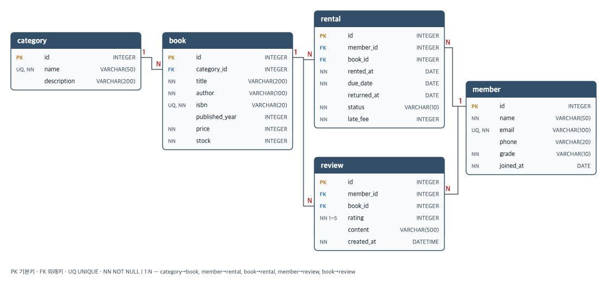

# 디지털 서랍장 — 도서 대여 DB

백엔드 프레임워크 없이 SQL만으로 **도서 대여 서비스**의 데이터 모델을 설계하고,
샘플 데이터를 넣고, 요구사항을 쿼리로 해결한 실습 결과물입니다.

- DB: **SQLite 3** (파일 기반, 서버 불필요) · 실행 도구: `sqlite3` CLI
- 기준일(오늘): **2026-09-28** — 결과 재현을 위해 쿼리에서 `DATE('now')` 대신 날짜 리터럴 사용

## 제출물 구성

| 요구 제출물 | 파일 |
| --- | --- |
| 스키마 생성 SQL | [sql/01_schema.sql](sql/01_schema.sql) |
| 샘플 데이터 INSERT SQL | [sql/02_data.sql](sql/02_data.sql) |
| 핵심 쿼리 SQL (18개) | [sql/03_queries.sql](sql/03_queries.sql) |
| 실행 결과 폴더 | [results/](results/) — 쿼리별 `Q01.txt` ~ `Q18.txt`, 행 수 `00_row_counts.txt` |
| (선택) ERD | [erd.png](erd.png) / [erd.svg](erd.svg) |
| (보너스) JOIN vs 서브쿼리 · FK 에러 · 미니 리포트 | [sql/04_bonus.sql](sql/04_bonus.sql), `results/B*.txt` |

## 실행 방법

한 번에 전부 (DB 재생성 → 모든 쿼리 실행 → `results/` 갱신):

```bash
python3 run_all.py
```

직접 순서대로 실행:

```bash
sqlite3 library.db < sql/01_schema.sql
sqlite3 library.db < sql/02_data.sql
sqlite3 -header -box library.db < sql/03_queries.sql
```

> SQLite는 FK 검사가 기본으로 꺼져 있고 **접속마다** 켜야 합니다.
> 그래서 모든 `.sql` 파일 맨 위에 `PRAGMA foreign_keys = ON;`(SQLite 전용)을 넣었습니다.

## 데이터 모델



| 테이블 | 역할 | 행 수 |
| --- | --- | --- |
| `category` | 도서 카테고리 | 10 |
| `member` | 회원 | 12 |
| `book` | 도서 | 15 |
| `rental` | 대여 기록 (대여일·반납 기한·반납일·상태·연체료) | 25 |
| `review` | 도서 리뷰 (평점 1~5) | 15 |

**1:N 관계 5개**

| 부모 (1) | 자식 (N) | FK |
| --- | --- | --- |
| category | book | `book.category_id → category.id` |
| member | rental | `rental.member_id → member.id` |
| book | rental | `rental.book_id → book.id` |
| member | review | `review.member_id → member.id` (ON DELETE CASCADE) |
| book | review | `review.book_id → book.id` (ON DELETE CASCADE) |

`member`와 `book`은 `rental`을 사이에 두고 **N:M** 관계가 됩니다. 한 회원은 여러 책을,
한 책은 여러 회원이 빌릴 수 있기 때문에, 그 "빌렸다는 사건"을 별도 테이블로 뺀 것입니다.

**제약조건**

- `NOT NULL`: `member.name`, `member.email`, `book.title`, `rental.rented_at` 등
- `UNIQUE`: `category.name`, `member.email`, `book.isbn`, `review(member_id, book_id)` (한 책에 리뷰 1번)
- `CHECK`: `rental.status IN ('RENTED','RETURNED','OVERDUE')`, `review.rating BETWEEN 1 AND 5`, `price >= 0`, `due_date >= rented_at`
- FK: 없는 값 참조 시 `FOREIGN KEY constraint failed` 로 막힘 → [results/B2-a.txt](results/B2-a.txt)

**의도적으로 넣은 데이터 특징** (쿼리 결과가 의미 있게 나오도록)

- 대여 기록이 없는 회원 2명(11, 12번) → LEFT JOIN · 서브쿼리 확인용
- 한 번도 대여되지 않은 도서 2권(14, 15번), 도서가 없는 카테고리 1개(여행)
- 반납 기한이 지났는데 상태가 아직 `RENTED`인 대여 2건(19, 20번) → UPDATE 대상

## 쿼리 목록

| # | 범주 | 무엇을 확인하는가 | 결과 |
| --- | --- | --- | --- |
| Q01 | 기본 조회 | 2만 원 이상 도서를 비싼 순으로 (`WHERE`, `ORDER BY`) | [Q01](results/Q01.txt) |
| Q02 | 기본 조회 | GOLD·SILVER 회원을 가입일 순으로 (`IN`) | [Q02](results/Q02.txt) |
| Q03 | 기본 조회 | 최근 대여 5건 (`LIMIT`) | [Q03](results/Q03.txt) |
| Q04 | 기본 조회 | 제목 키워드 검색 (`LIKE`) | [Q04](results/Q04.txt) |
| Q05 | 기본 조회 | 최근 30일 대여 기록 (`BETWEEN`) | [Q05](results/Q05.txt) |
| Q06 | INNER JOIN | 현재 대여 중인 책 + 빌린 회원 (3테이블) | [Q06](results/Q06.txt) |
| Q07 | INNER JOIN | 평점 4 이상 리뷰 + 카테고리·작성자 (4테이블) | [Q07](results/Q07.txt) |
| Q08 | LEFT JOIN | 회원별 대여 횟수, 0회 회원 포함 | [Q08](results/Q08.txt) |
| Q09 | LEFT JOIN | 한 번도 대여되지 않은 도서 (`IS NULL`) | [Q09](results/Q09.txt) |
| Q10 | 집계 | 카테고리별 도서 수·평균 가격 (`COUNT`, `AVG`) | [Q10](results/Q10.txt) |
| Q11 | 집계 | 회원별 연체 건수·연체료 합계 (`SUM`, `HAVING`) | [Q11](results/Q11.txt) |
| Q12 | 집계 | 도서별 평균 평점 랭킹 (`AVG`, `COUNT`) | [Q12](results/Q12.txt) |
| Q13 | 집계 | 월별 대여 건수 (`SUBSTR` — SQLite 전용 표기) | [Q13](results/Q13.txt) |
| Q14 | 서브쿼리 | 대여 기록이 없는 회원 (`NOT EXISTS`) | [Q14](results/Q14.txt) |
| Q15 | 서브쿼리 | 평균 가격보다 비싼 도서 (스칼라 서브쿼리) | [Q15](results/Q15.txt) |
| Q16 | UPDATE | 기한 지난 `RENTED` → `OVERDUE` (전/후 비교) | [Q16](results/Q16.txt) |
| Q17 | DELETE | 대여 기록 없는 탈퇴 회원 삭제 | [Q17](results/Q17.txt) |
| Q18 | 인덱스 | `rental(member_id)`, `rental(status, due_date)` + 실행 계획 전/후 | [Q18](results/Q18.txt) |

Q18 결과에서 인덱스 생성 전에는 `SCAN rental`(전체 스캔), 생성 후에는
`SEARCH rental USING INDEX idx_rental_status_due (status=? AND due_date<?)`로 바뀌는 것을 확인할 수 있습니다.

## 보너스

- **B1 JOIN vs 서브쿼리** — "연체 중인 대여의 회원 이름·책 제목"을 두 방식으로 풀고 결과가 같음을 확인.
  여러 컬럼을 붙일 때는 JOIN이 짧고 옵티마이저에 맡기기 좋으며, SELECT 절 서브쿼리는 값 하나를
  곁들일 때만 읽기 쉽다는 비교를 주석으로 정리.
- **B2 정합성 깨뜨리기** — 없는 회원(999)으로 대여 입력, 대여 기록이 있는 회원 삭제 → 둘 다 FK 에러.
  부모 먼저 넣고 자식을 넣는 순서로 고쳐 재입력 성공까지 기록.
- **B3 미니 리포트** — ① 월별 대여 추이와 전월 대비 증감(`LAG`) ② 인기 도서 TOP 5(`RANK`, 동률 유지)
  ③ 회원별 연체율.

## 정리: 과제 목표 질문에 대한 답

**엑셀과 DB는 뭐가 다른가?**
엑셀은 한 시트에 모든 걸 적기 쉬워서, 대여 기록 행마다 회원 이름·전화번호·책 제목을 반복해 적게 됩니다.
회원 전화번호가 바뀌면 모든 행을 찾아 고쳐야 하고, 하나라도 빠뜨리면 데이터가 서로 어긋납니다.
DB는 회원·도서·대여를 테이블로 나눠 **한 사실을 한 곳에만** 저장하고, 테이블 사이를 키로 연결합니다.
그리고 "없는 회원의 대여 기록은 안 된다" 같은 **규칙(제약조건)을 DB가 직접 강제**합니다.

**PK / FK와 1:N**
PK는 행 하나를 유일하게 가리키는 값(`member.id`), FK는 다른 테이블의 PK를 가리키는 값(`rental.member_id`)입니다.
회원 1명에 대여 기록이 여러 개 붙는 것이 1:N이고, N쪽 테이블이 FK를 가집니다.
FK 덕분에 `rental`은 회원 정보를 복사하지 않고 번호만 들고 있다가, 필요할 때 JOIN으로 붙여 봅니다.

**SELECT / INSERT / UPDATE / DELETE**
조회는 SELECT, 새 사실 추가는 INSERT(새 대여), 기존 사실의 상태 변경은 UPDATE(연체 처리, 반납 처리),
더 이상 필요 없는 데이터 제거는 DELETE(탈퇴). UPDATE/DELETE는 `WHERE`를 빠뜨리면 전체 행이 바뀌므로
같은 조건으로 SELECT를 먼저 돌려보고 실행했습니다(Q16).

**JOIN과 GROUP BY**
JOIN은 나눠 저장한 테이블을 FK = PK 조건으로 다시 옆으로 이어 붙이는 것이고,
GROUP BY는 이어 붙인 행을 기준 컬럼별로 묶어 `COUNT/SUM/AVG` 한 줄로 요약하는 것입니다.
INNER JOIN은 짝이 있는 행만, LEFT JOIN은 왼쪽 테이블 행을 모두 남기고 짝이 없으면 NULL을 채웁니다
(Q08에서 대여 0회 회원이 나오는 이유).

**인덱스**
인덱스는 책 뒤의 "찾아보기"처럼 특정 컬럼 값으로 행 위치를 바로 찾게 해줍니다.
`WHERE`, `JOIN ON`, `ORDER BY`에 자주 쓰이고 값 종류가 많은 컬럼(FK, 날짜, 상태+날짜 조합)에 걸면 효과가 크고,
대신 INSERT/UPDATE 때마다 인덱스도 갱신해야 하므로 아무 컬럼에나 걸지는 않습니다.

## DB 전용 문법 사용 목록

| 위치 | 문법 | 비고 |
| --- | --- | --- |
| 모든 파일 상단 | `PRAGMA foreign_keys = ON` | SQLite 전용. MySQL(InnoDB)/PostgreSQL은 FK 기본 활성 |
| Q13, B3-1 | `SUBSTR(...)` | 표준은 `SUBSTRING(x FROM 1 FOR 7)` |
| Q18 | `EXPLAIN QUERY PLAN` | SQLite 전용. MySQL/PostgreSQL은 `EXPLAIN` |
| 스키마 | `INTEGER PRIMARY KEY` | SQLite에서는 자동 증가 rowid 별칭. 이 과제는 id를 직접 넣음 |
